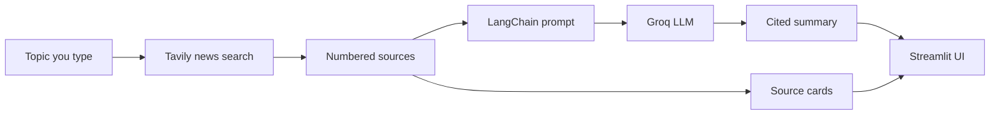

<div align="center">

# 📰 Briefly

### The news, minus the noise.

Pick a topic. Briefly searches the web and boils the latest stories down to what matters, with every claim linked back to its source.

<br>


<br>


</div>

---

## ✨ Features

| | |
|---|---|
| 🔎 **Live news search** | Pulls fresh articles from the web using Tavily's news mode. |
| 🧠 **Fast summaries** | Groq-hosted open models write the summary in a few seconds. |
| 🔗 **Cited answers** | Every point carries a source number like `[1]`, matching the source cards beside it. |
| 🎛️ **Your style** | Choose bullet points, a quick brief, or a themed deep dive. |
| 🗓️ **Time range** | Look at the past 24 hours, week, month, or year. |
| 🎚️ **Model control** | Switch between Groq models and tune creativity from the sidebar. |
| 💾 **Export** | Download any summary, with its sources, as a Markdown file. |

---

## 🧩 How it works



1. You enter a topic and choose a style, time range, and number of sources.
2. **Tavily** returns recent news articles for that topic.
3. The articles are numbered and passed into a **LangChain** prompt chain (`prompt | llm | parser`).
4. A **Groq** model writes the summary using only facts from those sources and cites them.
5. **Streamlit** shows the summary next to clickable source cards.

---

## 🛠️ Tech stack

- **[Streamlit](https://streamlit.io/)** for the interface
- **[LangChain](https://www.langchain.com/)** for the prompt and chain
- **[Groq](https://groq.com/)** for fast LLM inference
- **[Tavily](https://tavily.com/)** for web and news search
- **python-dotenv** for loading API keys

---

## 🚀 Getting started

### 1. Clone the repo

```bash
git clone https://github.com/Aarushi1512006/briefly-ai-news-summarizer.git
cd briefly-ai-news-summarizer
```

### 2. Create a virtual environment

```bash
python -m venv venv

# macOS / Linux
source venv/bin/activate

# Windows
venv\Scripts\activate
```

### 3. Install dependencies

```bash
pip install -r requirements.txt
```

### 4. Add your API keys

Copy the example file and fill in your keys:

```bash
cp .env.example .env
```

```env
GROQ_API_KEY=your_groq_key_here
TAVILY_API_KEY=your_tavily_key_here
```

Get your keys here:
- Groq: [console.groq.com](https://console.groq.com/keys)
- Tavily: [app.tavily.com](https://app.tavily.com/)

### 5. Run the app

```bash
streamlit run app.py
```

Open [http://localhost:8501](http://localhost:8501) in your browser.

---

## ⚙️ Settings

| Setting | What it does | Default |
|---|---|---|
| **Style** | Bullet points, quick brief, or deep dive | Bullet points |
| **News from** | Past 24 hours, week, month, or year | Past week |
| **Number of sources** | How many articles to search (3 to 10) | 5 |
| **Groq model** | `openai/gpt-oss-20b`, `openai/gpt-oss-120b`, `llama-3.3-70b-versatile` | `openai/gpt-oss-20b` |
| **Creativity** | Model temperature (0 to 1) | 0.2 |

---

## 📁 Project structure

```
briefly-ai-news-summarizer/
├── app.py                 # Streamlit app (UI + search + summarize)
├── requirements.txt       # Python dependencies
├── .env.example           # Template for your API keys
├── .gitignore
├── .streamlit/
│   └── config.toml        # Light theme and brand colors
└── docs/
    └── screenshot.png     # Screenshot used in this README
```

---

## 🗺️ Roadmap

- [ ] Search history so you can reopen past summaries
- [ ] Scheduled daily digests by email
- [ ] Multi-topic dashboards
- [ ] Streaming summaries as they are written
- [ ] Export to PDF

---

## 🤝 Contributing

Ideas and pull requests are welcome. Open an issue first if you plan a larger change.

---

## 👩‍💻 Author

**Aarushi**, B.Tech CSE (Artificial Intelligence) student at Poornima College of Engineering, Jaipur.

[](https://github.com/Aarushi1512006)
[](https://www.linkedin.com/in/aarushi-ahluwalia-8b3336330)

<div align="center">

If you found this useful, consider giving the repo a ⭐

</div>
